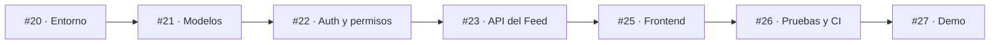
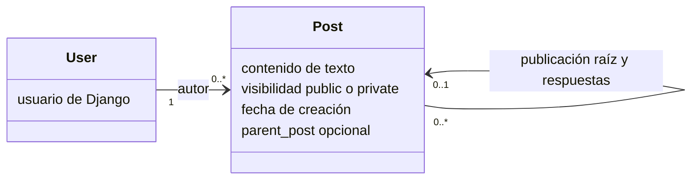

<h1 align="center">FraterChrist</h1>

<p align="center"><strong>Core Feed · MVP de una red social cristiana</strong></p>

<p align="center">
  <a href="LICENSE"></a>
  
  
</p>

<p align="center">
  <a href="#core-feed">Alcance</a> ·
  <a href="#punto-de-partida">Punto de partida</a> ·
  <a href="#documentación">Documentación</a>
</p>

> <p align="center"><em>Marcos 16:15 — «Id por todo el mundo y predicad el evangelio a toda criatura».</em></p>

<p align="center"><strong>Stack previsto</strong></p>
<p align="center">
  <a href="https://www.python.org/"></a>
  <a href="https://www.djangoproject.com/"></a>
  <a href="https://www.postgresql.org/"></a>
  <a href="https://react.dev/"></a>
  <a href="https://www.typescriptlang.org/"></a>
</p>

*El stack y los diagramas describen el diseño previsto; no significan que la aplicación ya esté implementada.*

---

## Core Feed

Una primera versión pequeña y demostrable para practicar análisis, modelado, API REST y desarrollo frontend:

- Registro, inicio y cierre de sesión.
- Publicaciones **solo de texto** y feed cronológico.
- Visibilidad **pública** o **privada**.
- Respuestas simples a publicaciones raíz.
- Edición y eliminación únicamente por parte del autor.
- Interfaz mínima que consume la API.

## Punto de partida

**Empieza por [Issue #20 — preparar Django, DRF y PostgreSQL](https://github.com/IsaacToDv/FraterChrist/issues/20).** Implementa cada etapa y verifica el resultado antes de avanzar.



### Modelo mínimo del Core



Una publicación sin padre es una raíz; una respuesta apunta directamente a esa raíz. Las respuestas heredan su visibilidad. La API, no la interfaz, aplica los permisos.

## Documentación

- [Requisitos funcionales y no funcionales](docs/REQUISITOS.md)
- [Arquitectura y diagramas](docs/ARQUITECTURA.md)
- [Plan de implementación](docs/PLAN-IMPLEMENTACION.md)
- [Progreso y bitácora de aprendizaje](Progreso/README.md)

## Fuera del Core

- **Issue #24:** fotos, videos y acceso protegido a archivos.
- **Issue #28:** visibilidad para miembros.
- Perfiles avanzados, likes, seguidores, mensajes, recomendaciones, salas, videollamadas, pizarras y juegos.

Estas funciones se retoman en fases futuras, después de completar y probar el Core.

## Estructura prevista

```text
FraterChrist/
├── backend/     # Django + API REST
├── frontend/    # React + TypeScript
├── docs/        # Requisitos, arquitectura y plan
└── Progreso/    # Bitácora y evidencia verificable
```

## Licencia

Este proyecto se distribuye bajo la licencia **GNU GPL v3.0**. Consulta [LICENSE](LICENSE).
