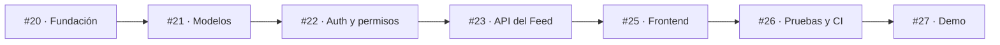
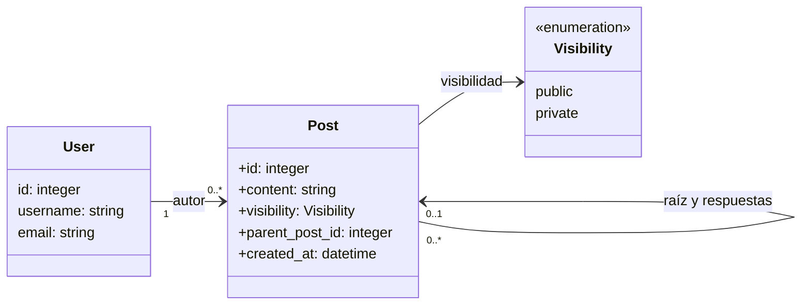

<h1 align="center">FraterChrist</h1>

<p align="center"><strong>Core Feed · MVP de una red social cristiana</strong></p>

<p align="center">
  <a href="LICENSE"></a>
  
  
</p>

<p align="center">
  <a href="#core-feed">Core Feed</a> ·
  <a href="#plan-de-implementación">Plan</a> ·
  <a href="#documentación">Documentación</a>
</p>

> <p align="center"><em>Marcos 16:15 — «Id por todo el mundo y predicad el evangelio a toda criatura».</em></p>

<p align="center"><strong>Stack previsto</strong></p>
<p align="center">
  <a href="https://www.python.org/"></a>
  <a href="https://www.djangoproject.com/"></a>
  <a href="https://www.postgresql.org/"></a>
  <a href="https://react.dev/"></a>
  <a href="https://www.typescriptlang.org/"></a>
</p>

*El stack y los diagramas describen el diseño previsto. La aplicación aún está en fase de planificación.*

---

## Core Feed

MVP centrado en las funciones esenciales para demostrar análisis, modelado de datos, API REST, autenticación, permisos y consumo de servicios desde una interfaz web.

- Registro e inicio/cierre de sesión.
- Publicaciones de texto en un feed cronológico.
- Visibilidad pública y privada.
- Respuestas directas a publicaciones.
- Edición y eliminación por parte del autor.
- Frontend mínimo conectado a la API.

## Plan de implementación

El desarrollo está organizado en issues pequeñas, cada una con alcance y criterios de aceptación.



Consulta el [backlog del proyecto](https://github.com/IsaacToDv/FraterChrist/issues), comenzando por la [Issue #20](https://github.com/IsaacToDv/FraterChrist/issues/20).

## Modelo mínimo



Una publicación raíz no tiene padre; cada respuesta apunta directamente a una raíz y hereda su visibilidad. La API es responsable de autorizar cada lectura o modificación.

## Documentación

- [Requisitos funcionales y no funcionales](docs/REQUISITOS.md)
- [Arquitectura, diagramas y rutas REST propuestas](docs/ARQUITECTURA.md)
- [Plan de implementación](docs/PLAN-IMPLEMENTACION.md)
- [Registro de progreso y aprendizaje](Progreso/README.md)

## Alcance futuro

- [Issue #24](https://github.com/IsaacToDv/FraterChrist/issues/24): fotos, videos y acceso protegido a archivos.
- [Issue #28](https://github.com/IsaacToDv/FraterChrist/issues/28): visibilidad para miembros.

Perfiles avanzados, likes, seguidores, mensajes, recomendaciones, salas, videollamadas, pizarras y juegos quedan fuera del Core.

## Estructura prevista

```text
FraterChrist/
├── README.md
├── LICENSE
├── compose.yaml
├── .env.example
├── .gitignore
├── .pre-commit-config.yaml
├── backend/
│   ├── pyproject.toml
│   ├── poetry.lock
│   ├── manage.py
│   ├── config/
│   └── apps/
│       ├── accounts/
│       └── feed/
├── frontend/
│   ├── package.json
│   ├── package-lock.json
│   └── src/
├── docs/
└── Progreso/
```

Esta estructura describe la organización objetivo; los archivos de implementación se incorporarán a medida que avance el MVP. Poetry y Ruff se destinan al backend Python; npm gestiona las dependencias del frontend. El archivo real `.env` permanece fuera de Git, y `.env.example` sirve como plantilla sin secretos. Django leerá variables del entorno o utilizará un cargador explícitamente configurado.

## Planificación y uso de IA

OpenAI, conectado al repositorio mediante GitHub MCP, se utilizó como apoyo para organizar el backlog, definir requisitos y criterios de aceptación, explorar la arquitectura y preparar diagramas UML. La dirección del producto y las iteraciones de planificación fueron guiadas por el autor, que propuso las ideas, priorizó cambios y aportó correcciones y mejoras.

Durante la implementación, la IA se plantea como herramienta de apoyo para comprender conceptos, analizar errores y comparar alternativas. El objetivo formativo es priorizar la comprensión y la escritura consciente del código: probar, equivocarse, depurar y aprender, evitando generar código de forma automática sin entenderlo ni poder explicarlo.

## Licencia

Este proyecto se distribuye bajo la licencia **GNU GPL v3.0**. Consulta [LICENSE](LICENSE).
