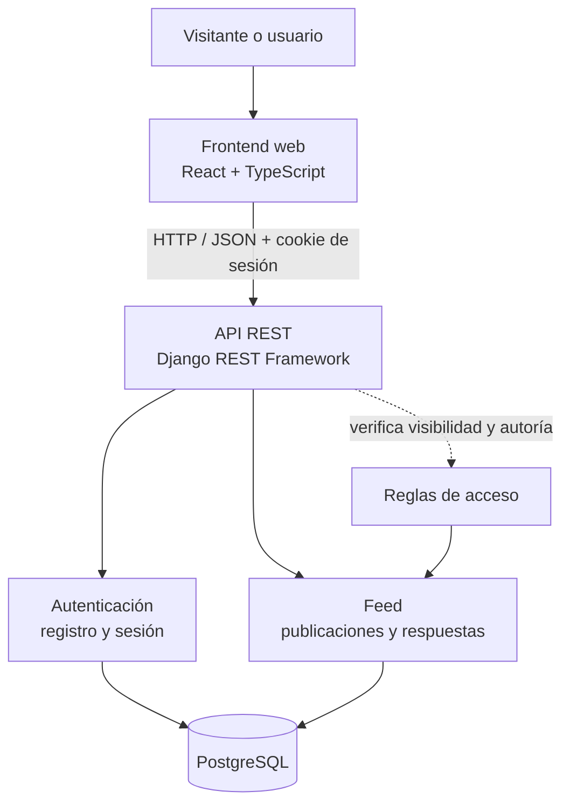
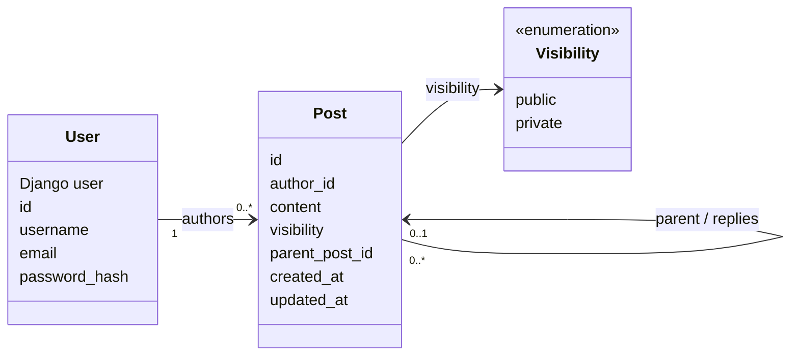
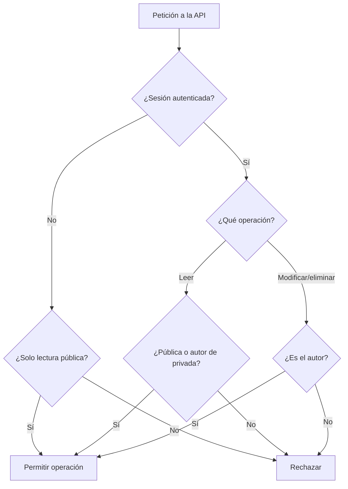

# Arquitectura — Core Feed

**Estado:** propuesta de diseño. La aplicación todavía no está implementada.

## Decisiones principales

- **Backend:** Python, Django y Django REST Framework.
- **Base de datos:** PostgreSQL.
- **Frontend:** React, TypeScript y Vite.
- **Autenticación:** sesiones de Django y protección CSRF para operaciones mutables.
- **Arquitectura:** monolito modular; sin microservicios.
- **Contenido:** solo texto; visibilidad pública o privada.

## Diagrama de componentes



La interfaz presenta los datos y recoge las acciones. La API autentica al usuario, valida cada operación y decide qué registros puede leer o modificar.

## Modelo de dominio



### Reglas del modelo

- Se reutiliza el usuario de Django; si se decide un modelo personalizado, debe definirse antes de la primera migración.
- Una publicación raíz tiene `parent_post = null`.
- Una respuesta apunta directamente a una publicación raíz. No se permiten respuestas a respuestas en el Core.
- Una respuesta hereda la visibilidad de la raíz; no puede hacerse más pública que su hilo.
- `password_hash` en el diagrama es conceptual: Django gestiona el hash en su campo de contraseña. Nunca se almacena la contraseña original.
- No hay modelo `MediaFile` ni campos de archivo en el Core.

## Flujo de autorización



Este flujo es una guía de diseño; debe implementarse y probarse en cada endpoint, incluidos los de respuestas.

## Rutas REST propuestas

| Método | Ruta | Uso |
|---|---|---|
| POST | `/api/auth/register/` | Registrar una cuenta. |
| POST | `/api/auth/login/` | Iniciar sesión. |
| POST | `/api/auth/logout/` | Cerrar sesión. |
| GET | `/api/auth/me/` | Consultar la sesión actual. |
| GET | `/api/posts/` | Listar publicaciones raíz visibles, cronológicamente. |
| POST | `/api/posts/` | Crear publicación de texto. |
| GET | `/api/posts/{id}/` | Consultar una publicación autorizada. |
| PATCH | `/api/posts/{id}/` | Editar como autor. |
| DELETE | `/api/posts/{id}/` | Eliminar como autor. |
| GET | `/api/posts/{id}/replies/` | Listar respuestas autorizadas. |
| POST | `/api/posts/{id}/replies/` | Crear una respuesta directa a una raíz. |

Las rutas son propuestas y pueden ajustarse durante la implementación, actualizando requisitos, diagramas y ejemplos de forma consistente.

## Estructura prevista

```text
backend/
├── manage.py
├── config/
└── apps/
    ├── accounts/
    └── feed/

frontend/
└── src/
    ├── app/
    ├── features/
    │   ├── auth/
    │   └── feed/
    └── shared/
```

## Fuera del Core

La visibilidad para miembros está pospuesta a la [issue de expansión](https://github.com/IsaacToDv/FraterChrist/issues). Fotos, videos y el control de acceso de archivos se posponen en la [Issue #24](https://github.com/IsaacToDv/FraterChrist/issues/24). No introducir estas funciones hasta que los flujos principales estén funcionando y probados.
