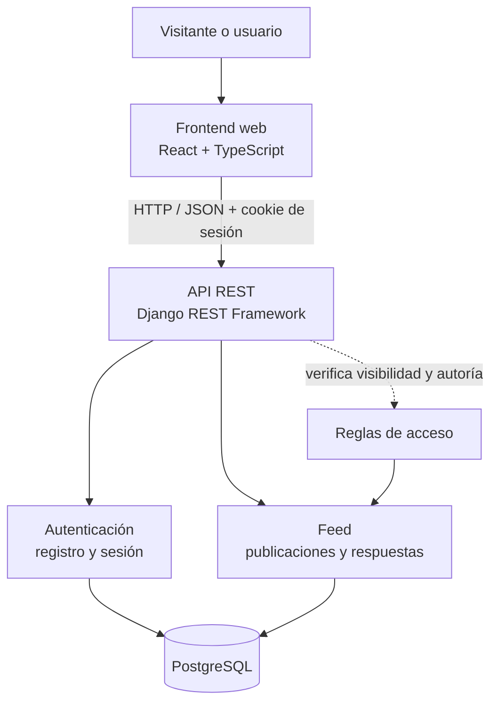
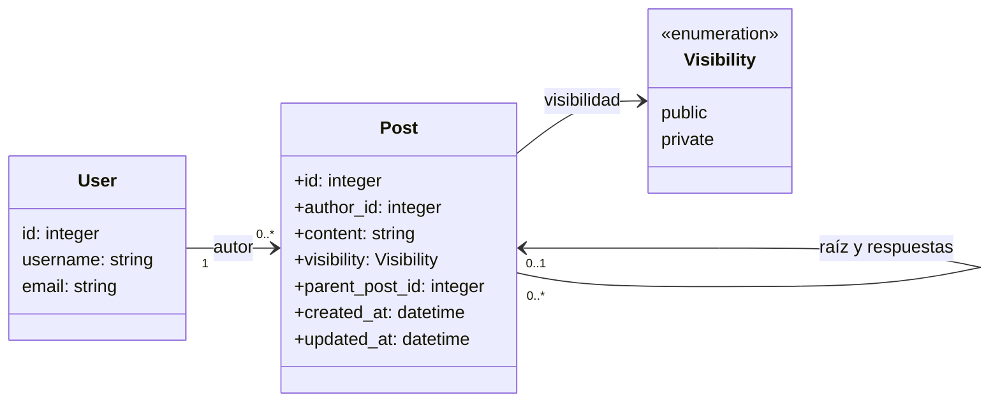
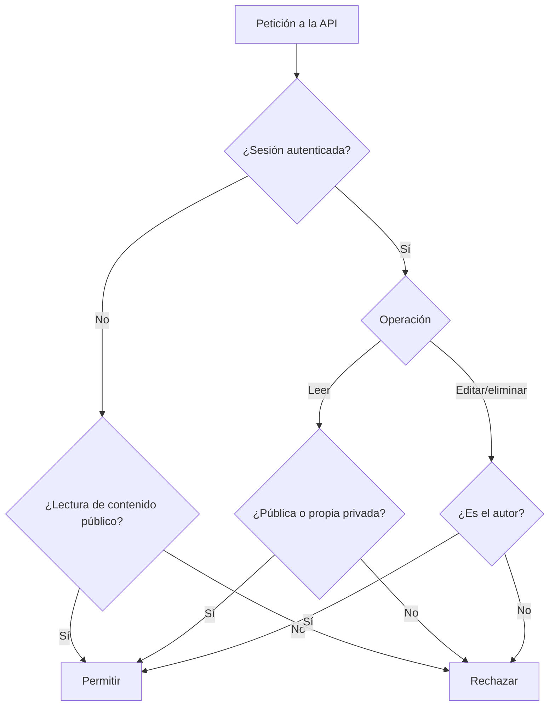

# Arquitectura — Core Feed

**Estado:** propuesta de diseño; la aplicación todavía no está implementada.

## Decisiones principales

- **Backend:** Python, Django y Django REST Framework.
- **Base de datos:** PostgreSQL.
- **Frontend:** React, TypeScript y Vite.
- **Autenticación:** sesiones de Django con protección CSRF para operaciones mutables.
- **Estilo arquitectónico:** monolito modular.
- **Contenido:** texto, visibilidad pública/privada y respuestas directas.

## Diagrama de componentes



La interfaz presenta datos y recoge acciones. La API autentica al usuario, valida la entrada y decide qué registros puede leer o modificar. El correo es obligatorio para el registro, pero se trata como dato privado: no se devuelve en el feed ni en las respuestas públicas de la API. Solo se expone al propio titular en el endpoint de cuenta autenticada.

## Modelo de dominio



### Reglas del modelo

- Los atributos del diagrama describen datos del dominio; no definen por sí solos qué campos se exponen en la API. No se muestran modificadores de visibilidad UML para evitar confundirlos con la visibilidad de las publicaciones.
- El correo se solicita durante el registro y se conserva como dato privado de la cuenta. No se incluye en serializadores públicos del feed ni se expone a otros usuarios.

- Se reutiliza el usuario de Django. Si se crea uno personalizado, debe definirse antes de la primera migración.
- Una raíz no tiene publicación padre; una respuesta apunta directamente a la raíz.
- No se permiten respuestas a respuestas en el Core.
- Una respuesta hereda la visibilidad de la raíz y nunca amplía el acceso al hilo.
- Django almacena contraseñas como hashes, no en texto plano.
- El Core no tiene modelo de archivos ni campos de multimedia.

## Flujo de autorización



Este flujo describe el comportamiento esperado. Debe implementarse y probarse en cada endpoint, incluidas las respuestas.

## Rutas REST propuestas

| Método | Ruta | Uso |
|---|---|---|
| POST | /api/auth/register/ | Registro. |
| POST | /api/auth/login/ | Inicio de sesión. |
| POST | /api/auth/logout/ | Cierre de sesión. |
| GET | /api/auth/me/ | Consultar sesión actual. |
| GET | /api/posts/ | Listar raíces visibles, cronológicamente. |
| POST | /api/posts/ | Crear publicación de texto. |
| GET | /api/posts/{id}/ | Consultar una publicación autorizada. |
| PATCH | /api/posts/{id}/ | Editar como autor. |
| DELETE | /api/posts/{id}/ | Eliminar como autor. |
| GET | /api/posts/{id}/replies/ | Listar respuestas de una raíz visible. |
| POST | /api/posts/{id}/replies/ | Crear respuesta directa. |

Son rutas propuestas y pueden ajustarse durante la implementación; cualquier cambio debe reflejarse en requisitos, pruebas y documentación.

## Estructura prevista

```text
backend/
├── manage.py
├── config/
└── apps/
    ├── accounts/
    └── feed/

frontend/
└── src/
    ├── app/
    ├── features/
    │   ├── auth/
    │   └── feed/
    └── shared/
```

## Expansión posterior

- [Issue #24 — multimedia y acceso protegido a archivos](https://github.com/IsaacToDv/FraterChrist/issues/24).
- [Issue #28 — visibilidad para miembros](https://github.com/IsaacToDv/FraterChrist/issues/28).

Estas funciones quedan fuera del Core hasta completar y probar el flujo principal.
